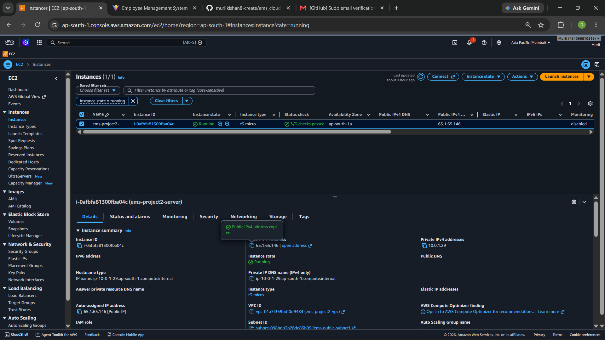
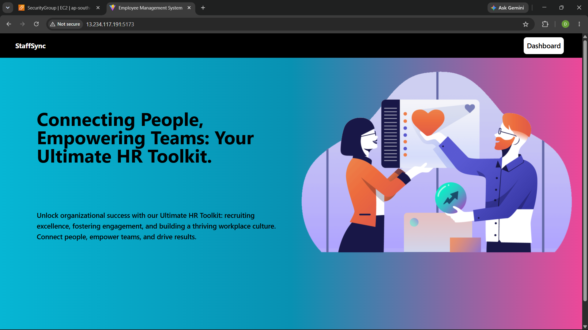
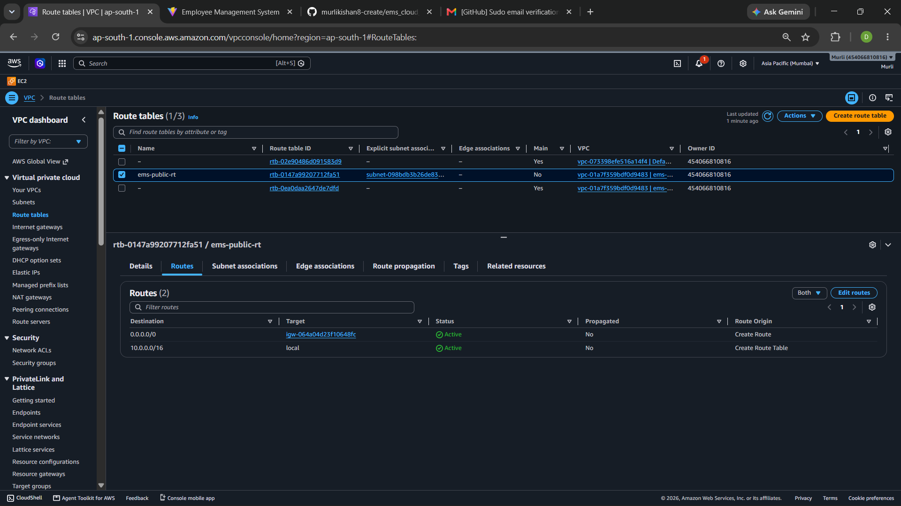
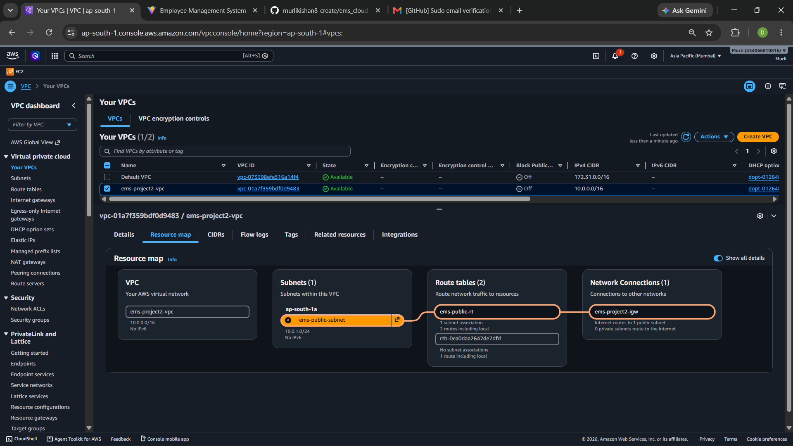

# EMS Deployment on AWS EC2

This project deploys the Employee Management System on an AWS EC2 instance using Docker Compose.

I created a custom VPC, configured the required networking and security group, and deployed the application on an Ubuntu EC2 instance.

## Tools Used

* AWS EC2, VPC and Security Groups
* Docker and Docker Compose
* Docker Hub
* Nginx
* MongoDB

## How It Works

1. Docker images are pulled from Docker Hub.
2. Docker Compose starts the frontend, backend and MongoDB containers.
3. Nginx forwards API requests to the backend.
4. The backend connects to MongoDB using the Docker network.
5. Users access the application through the EC2 instance.

## What I Learned

* Deploying a containerized application on EC2.
* Configuring AWS networking and security groups.
* Connecting containers through Docker Compose.
* Fixing frontend API requests that incorrectly used `localhost`.
* Using Nginx to forward API requests to the backend.

## Project Status

The deployment was tested on AWS EC2. The AWS resources have since been deleted to avoid ongoing costs.

This project was a hands-on exercise in deploying an application on AWS.

## Screenshots

### EC2 Instance

### Employee Management System application

### AWS Networking

The public route table and subnet association.

### EC2 Docker Setup

Docker installation and service status on the EC2 instance.

### Vpc setup

## Project Decisions

See [DECISIONS.md](DECISIONS.md) for the problems encountered and the decisions made during deployment.
